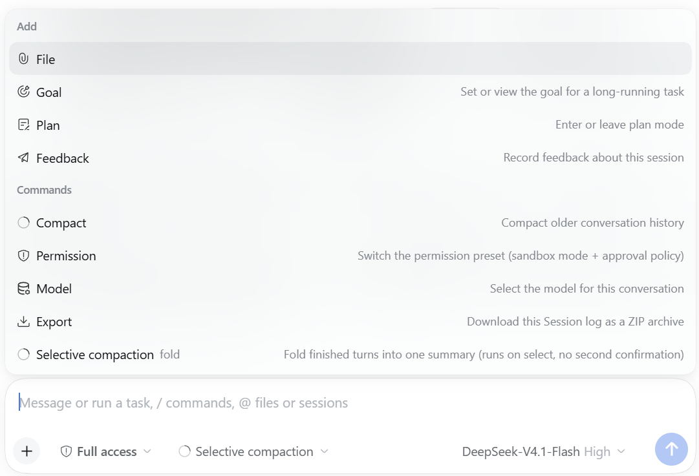
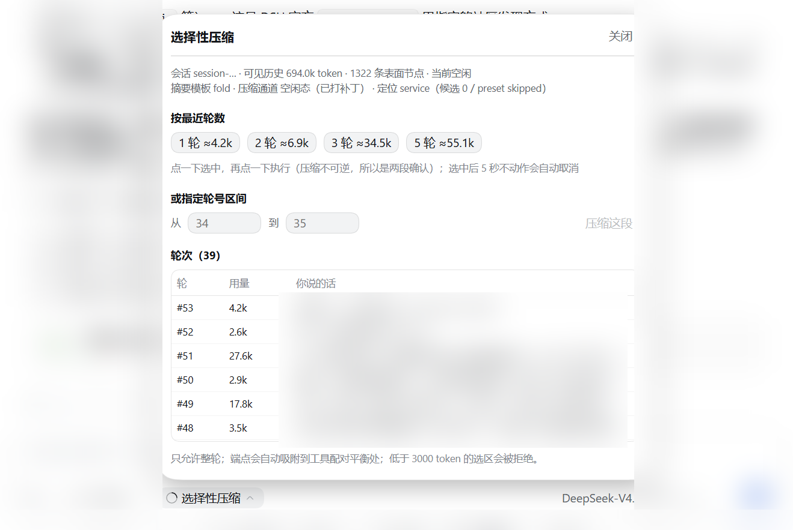
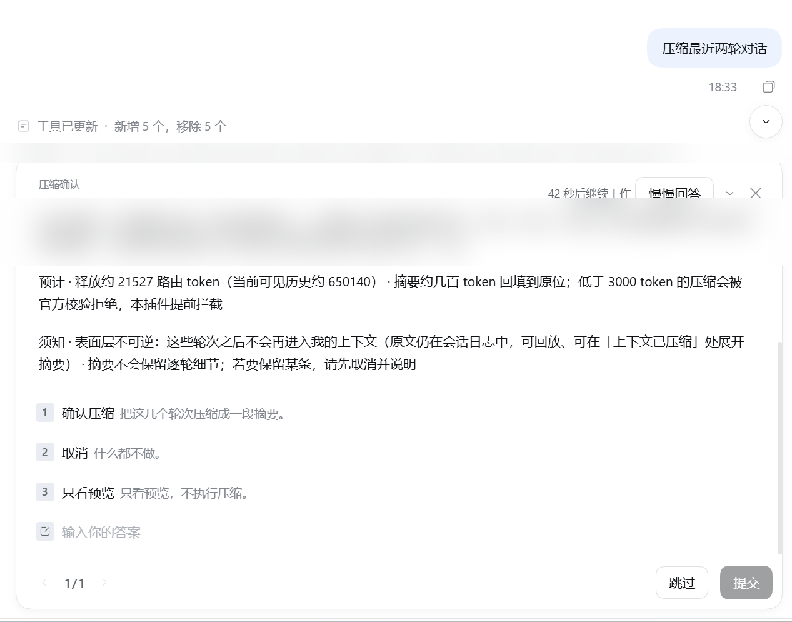

# dsh-compaction-selective

**Human-directed selective compaction for DeepSeek Harness (DSH).**

DSH's built-in compaction always folds *the oldest span*, and `/compact` accepts no arguments.
But the span you usually want to get rid of is a *recent* side branch — a debugging detour, a dead-end
Q&A, a pile of tool output. This plugin adds the missing entry point: **you say which finished turns to
compact**, and exactly that span is folded into one summary.

Built on DeepSeek Harness — an unofficial community plugin, not affiliated with or endorsed by DeepSeek.

由人指定「压缩哪几轮」的 DeepSeek Harness 插件——把已经结束的一段对话折成一条摘要，
而不是只能让系统挑最老的那段。工具调用、输入框面板、`+` 菜单三个入口，执行前必须人工确认。

**English** | [简体中文](README.zh.md)

---

## Screenshots

**1 · The `+` menu → Commands → *Selective compaction*** — the plugin also lives where every DSH command lives.



**2 · The composer panel** — session overview, token estimates for the last 1/2/3/5 turns, an explicit turn range, and the turn table.
Actions use a two-step confirm that auto-cancels after 5 seconds.



**3 · The approval card (tool path)** — exact range, node count and estimated release; nothing changes
until a human presses *Confirm compaction*.



*Screenshots are redacted: session text outside the UI being demonstrated is blurred.*

*The UI follows the host UI language — English or Chinese. If the host reports no language, labels stay Chinese. Screenshots were taken with the host language set to English.*

---

## What it does

1. **Pick a span of *finished* turns** — "the last two turns", or an explicit range like `34-35`.
2. **Preview and confirm** — the tool path shows a confirmation card with the exact turns, node count and
   estimated token release. Nothing changes until a human approves.
3. **Folds that span into one summary** with a fold-shaped template (keeps decisions, file paths, API
   endpoints and open questions; drops the play-by-play), then replaces the span in the visible surface.

Original events are never deleted: the span stays in the session log and the summary can be expanded.

## Feature matrix

| Entry point | Web (CLI) | Desktop app (Electron) |
|---|---|---|
| Model tool `compact_turns` + approval card | ✅ | ✅ |
| Composer button / panel (overview, turn table) | ✅ | ✅ |
| `+` menu → 指令 → 选择性压缩 | ✅ | ✅ (hidden when unsupported) |
| Fold-shaped summary template | ✅ | ✅ |
| **Idle-span compaction from panel/menu** | ✅ *(needs a 15-line local patch)* | ❌ *(core is packed in `app.asar`)* |

That last row is an **upstream API gap**, not a plugin bug: DSH exposes `compactNow` (idle, but the span
is chosen for you) and `compactRegion` (explicit span, but only while a turn is open). The combination —
*idle + explicit span* — has no public entry point yet. On a CLI install we bridge it with
`patches/apply-compaction-patch.ps1`; on the desktop app the core is packed inside `app.asar` and cannot
be patched. When unsupported, the plugin **disables the actions and tells you to use the conversation
form instead** — it never leaves you clicking into an error.

## Install

```text
# 1. link the package into your DSH profile  (~/.dsh/profiles/<profile>/package.json)
"dependencies": { "dsh-compaction-selective": "link:<path-to-this-repo>" }

# 2. enable it as a bundle
"dsh": { "profile": { "bundles": [ "...", "dsh-compaction-selective" ] } }

# 3. link it into the profile's node_modules
#    Windows:  cmd /c mklink /J <profile>\node_modules\dsh-compaction-selective <path-to-this-repo>
#    POSIX:    ln -s <path-to-this-repo> <profile>/node_modules/dsh-compaction-selective
```

Restart DSH. The plugin appears under **插件 / Plugins**, its settings live on its own detail page, and
the browser needs a refresh to pick up the client bundle.

## Configuration

Settings live in `~/.dsh/compaction-selective.json` (plugin-owned JSON, edited from the plugin detail
page). Effective config = built-in defaults < `config:` on the bundle row < settings file.

| Key | Default | Meaning |
|---|---|---|
| `enabled` | `true` | Master switch |
| `minShadowedTokens` | `3000` | Selection floor. Below it the official "summary must be smaller" check rejects the fold, so we reject earlier |
| `maxSurfaceShare` | `0.6` | Max share of the visible surface one fold may cover |
| `approvalTimeoutMs` | `180000` | How long the confirmation card waits before counting as "not confirmed" |
| `maxPerTurn` | `1` | Folds allowed per turn |
| `foldSummary` | `true` | Use the fold-shaped summary template (disable to keep the stock one) |

## Guardrails (deliberate, do not weaken)

- **Human confirmation is mandatory** before any fold (approval card; cancel/timeout changes nothing).
- **Only finished turns** can be folded; the open turn is refused.
- **Node 0 (the system prompt) is never touched.**
- **Never guesses the session** — if the client cannot determine it, it asks you to pick.
- Panel actions sit behind a **two-step confirm with a 5-second auto-cancel**.

## Compatibility

**Supported: DSH `0.2.0` – `0.2.2`.**

| Version | Status |
|---|---|
| `0.2.0-rc.2` | verified on a live install (full suite + real folds) |
| `0.2.1-alpha.1 … 0.2.1-rc.2` | audited against upstream source (zero breaking changes inside that window) |
| `0.2.1-rc.2` | verified on a live install (client-path fold: 49 nodes, ~28.8k tokens released) |
| `0.2.2-rc.1` | verified on a live install (desktop app: loads, `agentPresets.serviceFor` resolution, fold template active, HTTP 200) |

Declared range: `engines.dsh: ">=0.2.0-rc.2 <0.3.0"`. DSH 0.2.1 introduced an `engines.dsh` gate that
takes precedence over `peerDependencies`; an unsatisfied range blocks installation (upstream offers
`dsh plugin allow-version` for exact-version waivers).

The plugin rides on contracts that are documented in code but not API-frozen (slot contracts,
`compactRegion`, `dsh.bundle.patch`, `dsh.client`). It is maintained and will follow DSH. After a DSH
upgrade: re-run `patches/apply-compaction-patch.ps1` (idempotent; fails loudly without touching files if
upstream changed shape) and `npm test`.

Upstream ask for the missing API: [deepseek-ai/deepseek-harness#discussions/12813](https://github.com/deepseek-ai/deepseek-harness/discussions/12813).

## Tests

```bash
npm test            # 125 core assertions + 12 busy-state + 9 auto-cancel + render tree-check + slot handshake
```

## Attribution

- Two 16×16 SVG icons are taken from `@deepseek-ai/dsh-client-ui-primitives` (MIT, DeepSeek Harness).
  See [NOTICE](./NOTICE).
- `@deepseek-ai/dsh*` packages are **not** bundled; the host provides them (`peerDependencies`, all optional).

## Uninstall

Remove the package name from `dsh.profile.bundles` and the `dependencies` row, delete the link, restart.
If you applied the local patch, restore the `*.bak-*` backups written by the patcher.

## License

MIT — see [LICENSE](./LICENSE).

---

**关键词 / Keywords**：选择性压缩 · 压缩上下文 · 上下文管理 · DeepSeek Harness 插件 · DSH plugin ·
selective compaction · context compaction · context management · compact specific turns
