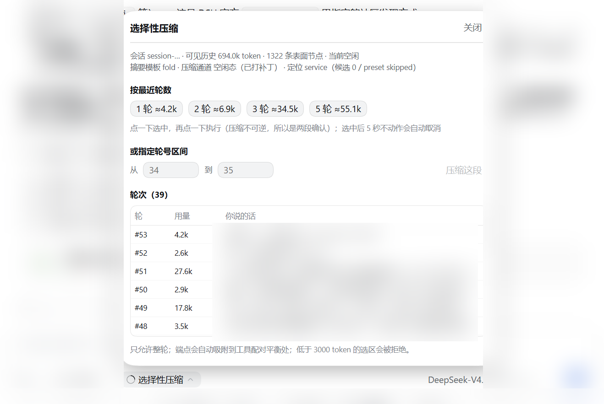
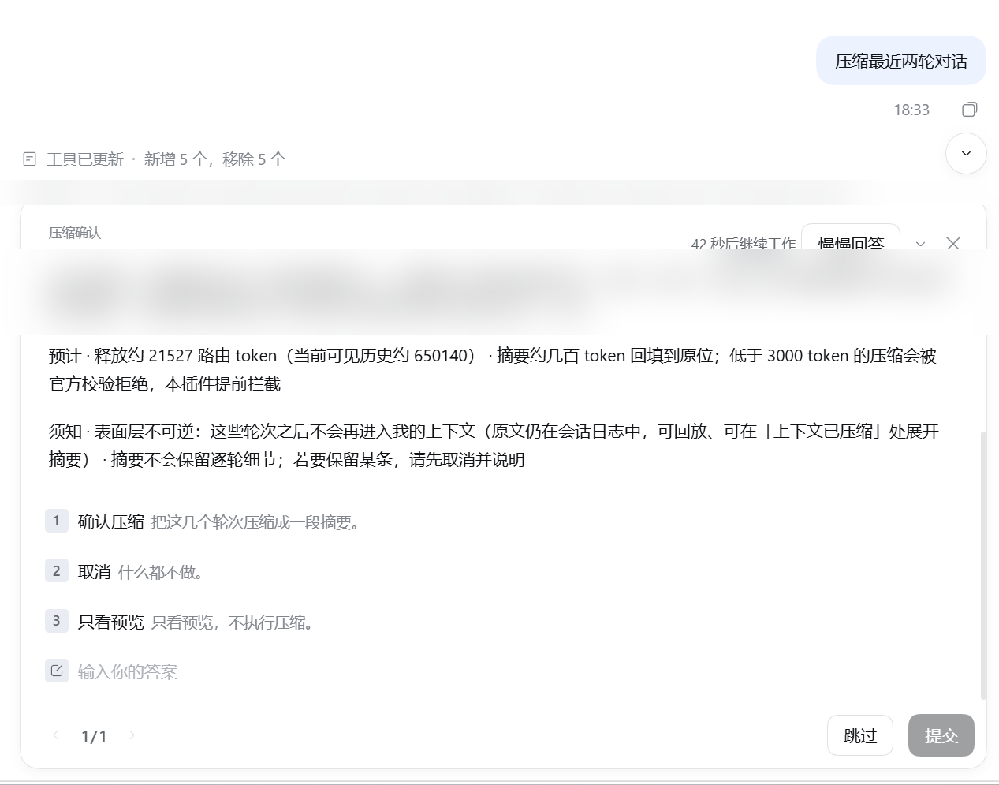

# dsh-compaction-selective

**[English](README.md)** | 简体中文

**由人指定「压缩哪几轮」的 DeepSeek Harness 插件。**

DSH 自带的压缩只会把**最老的一段**历史折起来（`/compact` 也不收参数）。但真正想清掉的往往是**最近**插进来的
一段支线——一次排障、一段走不通的问答、一堆工具输出。这个插件补的就是那个入口：**由你说压缩哪几轮**，
把这段折成一条摘要。

本插件是社区作品，基于 DeepSeek Harness 构建，**非官方、未获官方背书**。

---

## 截图

**1 · `+` 菜单 → 指令 → 选择性压缩** —— 插件也出现在 DSH 所有指令所在的地方。


**2 · 输入框面板** —— 会话概况、最近 1/2/3/5 轮的 token 预估、任意轮号区间、以及轮次表。
执行是两段确认，选中后 5 秒不动作会自动取消。



**3 · 确认卡（工具路径）** —— 写明范围、节点数与预计释放量；**在你点「确认压缩」之前，什么都不会改**。



*截图已脱敏：除被演示的界面本身，其余会话文字都做了高斯模糊。*

*界面语言**跟随宿主**（English / 中文）；宿主报不出语言时保持中文。截图是在中文宿主下拍的。*

---

## 它能做什么

1. **指定一段「已结束」的轮次** —— 「最近两轮」，或明确的区间（例如 `34-35`）。
2. **先预览再确认** —— 工具路径会弹确认卡，列出具体轮次、表面节点数、预计释放的 token；
   人类同意之前不改任何东西。
3. **折成一条摘要** —— 使用「局部压缩」模板（保留决策、文件路径、API 端点、未决问题；丢掉逐句流水账），
   然后原位替换可见表面。

原文**永不删除**：被折的轮次仍在会话日志里，摘要可展开。

## 功能矩阵

| 入口 | Web（CLI） | 桌面端（Electron） |
|---|---|---|
| 模型工具 `compact_turns` + 确认卡 | ✅ | ✅ |
| 输入框按钮 / 面板（概况、轮次表） | ✅ | ✅ |
| `+` 菜单 → 指令 → 选择性压缩 | ✅ | ✅（不支持时自动隐藏） |
| 「局部压缩」摘要模板 | ✅ | ✅ |
| **面板/菜单里的「空闲态压缩」** | ✅（需要 15 行本地补丁） | ❌（核心打包在 `app.asar` 里） |

最后一行是**上游 API 缺口**，不是插件 bug：DSH 提供了 `compactNow`（空闲态，但区间由它自己挑）和
`compactRegion`（能收显式区间，但要求有打开的轮次）。两者组合——**空闲 + 指定区间**——目前没有公开入口。
在 CLI 安装上我们用 `patches/apply-compaction-patch.ps1` 桥接；桌面端的核心打包在 `app.asar` 里，无法打补丁。
**不支持时会禁用按钮并提示改用对话指令**，不会让人点了才报错。

## 安装

```text
# 1. 把包 link 进 DSH profile（~/.dsh/profiles/<profile>/package.json）
"dependencies": { "dsh-compaction-selective": "link:<本仓库路径>" }

# 2. 作为 bundle 启用
"dsh": { "profile": { "bundles": [ "...", "dsh-compaction-selective" ] } }

# 3. 在 profile 的 node_modules 里建联接
#    Windows:  cmd /c mklink /J <profile>\node_modules\dsh-compaction-selective <本仓库路径>
#    POSIX:    ln -s <本仓库路径> <profile>/node_modules/dsh-compaction-selective
```

重启 DSH。插件会出现在「插件」页，它的设置在自己的详情页里；浏览器端需要刷新一次才能加载客户端 bundle。

## 配置

设置存在 `~/.dsh/compaction-selective.json`（插件自有 JSON，从插件详情页修改）。
生效配置 = 内置默认 < bundle 行的 `config:` < 设置文件。

| 键 | 默认 | 含义 |
|---|---|---|
| `enabled` | `true` | 总开关 |
| `minShadowedTokens` | `3000` | 选区下限。低于它会被官方「摘要必须更小」校验拒绝，所以提前拦截 |
| `maxSurfaceShare` | `0.6` | 单次最多压缩可见表面的比例 |
| `approvalTimeoutMs` | `180000` | 确认卡等待时间，超时视为未确认 |
| `maxPerTurn` | `1` | 同一轮内最多压缩几次 |
| `foldSummary` | `true` | 使用「局部压缩」摘要模板（关掉则保留出厂模板） |

## 护栏（刻意为之，不要削弱）

- **必须人工确认**才执行（确认卡；取消或超时都不改动任何内容）。
- **只压已结束的轮次**，进行中的那一轮会被拒绝。
- **永不触碰节点 0（系统提示）**。
- **绝不猜会话**：判定不出时让你自己选。
- 面板动作有**两段确认 + 5 秒自动取消**。

## 兼容性

**支持范围：DSH `0.2.0` – `0.2.2`。**

| 版本 | 状态 |
|---|---|
| `0.2.0-rc.2` | 实机验证（全量测试 + 真压缩） |
| `0.2.1-alpha.1 … 0.2.1-rc.2` | 源码级审计（该窗口内无破坏性变更） |
| `0.2.1-rc.2` | 实机验证（客户端路径压缩：49 节点，约释放 28.8k token） |
| `0.2.2-rc.1` | 实机验证（桌面端：加载正常、`agentPresets.serviceFor` 定位命中、摘要模板生效、HTTP 200） |

声明区间：`engines.dsh: ">=0.2.0-rc.2 <0.3.0"`。DSH 0.2.1 起有 `engines.dsh` 闸门，优先级高于
`peerDependencies`；不满足会**拦截安装**（上游提供 `dsh plugin allow-version` 做精确豁免）。

插件依赖的是「代码里有、但未冻结成 API」的契约（槽位契约、`compactRegion`、`dsh.bundle.patch`、`dsh.client`）。
它会被持续维护并跟随 DSH 版本。**DSH 升级后请**：重跑 `patches/apply-compaction-patch.ps1`（幂等；
上游改动形状时会报错且不改文件），再跑 `npm test`。

缺失 API 的上游需求帖：[deepseek-ai/deepseek-harness#discussions/12813](https://github.com/deepseek-ai/deepseek-harness/discussions/12813)。

## 测试

```bash
npm test            # 125 项内核断言 + 12 项执行态 + 9 项自动取消 + 表单树校验 + 槽位握手
```

## 署名

- 两个 16×16 SVG 图标取自 `@deepseek-ai/dsh-client-ui-primitives`（MIT，DeepSeek Harness），见 [NOTICE](./NOTICE)。
- `@deepseek-ai/dsh*` 包**不随本仓库分发**；由宿主提供（`peerDependencies`，均为 optional）。

## 卸载

从 `dsh.profile.bundles` 与 `dependencies` 里删掉包名，删除联接，重启。
如果打过本地补丁，用补丁脚本写下的 `*.bak-*` 备份恢复。

## 许可

MIT —— 见 [LICENSE](./LICENSE)。
